# Práctica de virtualización: Ubuntu, Docker, Nginx y Tomcat

## 1. Objetivo de la práctica

En esta práctica he utilizado Ubuntu dentro de VirtualBox y he instalado Docker Engine para ejecutar dos contenedores: Nginx como servidor web y Tomcat como servidor de aplicaciones. Después he comprobado desde el navegador que los dos funcionan.

## 2. Ubuntu y configuración de la máquina virtual

He utilizado una máquina virtual con Ubuntu. En la comprobación posterior con cat /etc/os-release apareció Ubuntu 24.04 LTS. Aunque VirtualBox muestra la etiqueta Ubuntu 24.10, esa etiqueta no corresponde a la versión que se comprobó dentro del sistema.

La captura de configuración muestra 4096 MB de RAM, 4 procesadores, un disco virtual de 25 GB y una conexión de red NAT. El escritorio de Ubuntu ya aparece funcionando.

En la unidad óptica se ve el CD de Guest Additions, pero tenerlo insertado no demuestra que se haya terminado su instalación. Tampoco se ha confirmado una ampliación del disco: la captura sigue mostrando 25 GB. Estos puntos quedan pendientes de comprobar; el requisito de 50 GB indicado en la revisión anterior no queda acreditado.

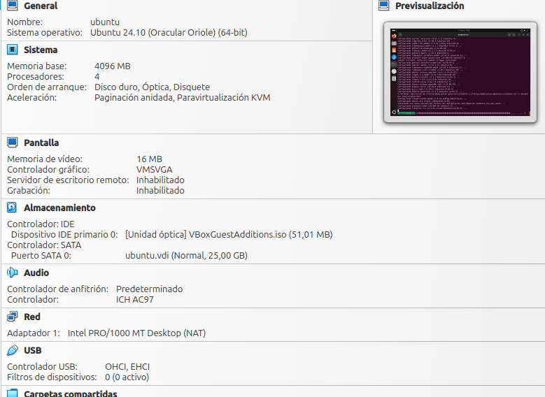

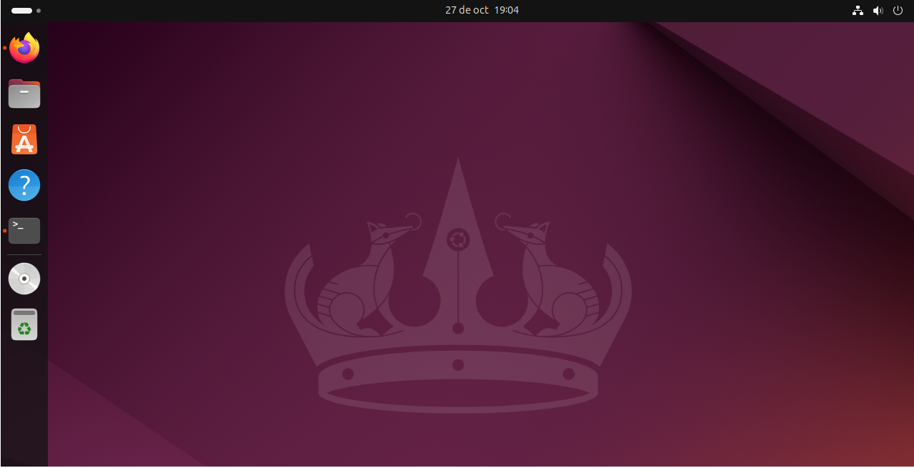

## 3. Actualización de Ubuntu

Antes de instalar Docker ejecuté este comando para actualizar la lista de paquetes y los paquetes instalados:

```bash
sudo apt update && sudo apt upgrade -y
```

apt update consulta las versiones disponibles y apt upgrade instala las actualizaciones. La opción -y acepta automáticamente las confirmaciones. La captura recoge el proceso de actualización.

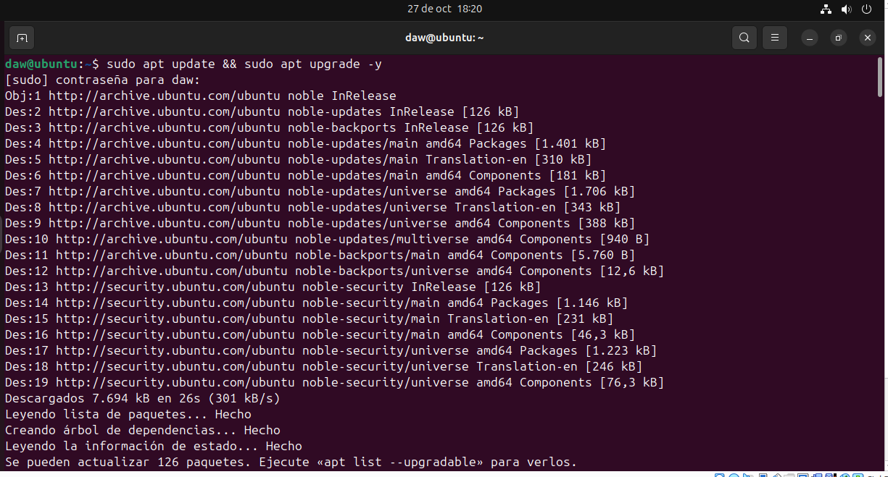

## 4. Instalación de las dependencias

Instalé los paquetes necesarios para trabajar con certificados, descargas y claves:

```bash
sudo apt install ca-certificates curl gnupg -y
```

ca-certificates permite comprobar certificados, curl sirve para descargar contenido desde la terminal y gnupg permite trabajar con firmas y claves. Al repetir el comando, Ubuntu indicó que ya estaban instalados.

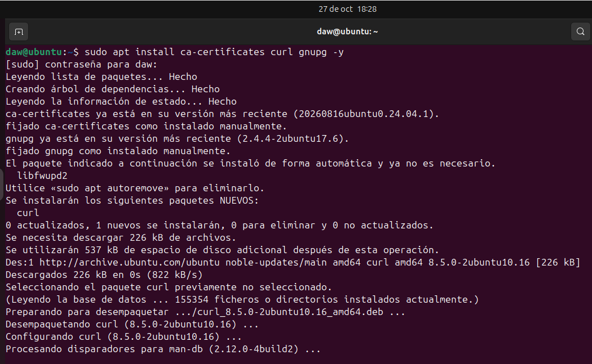

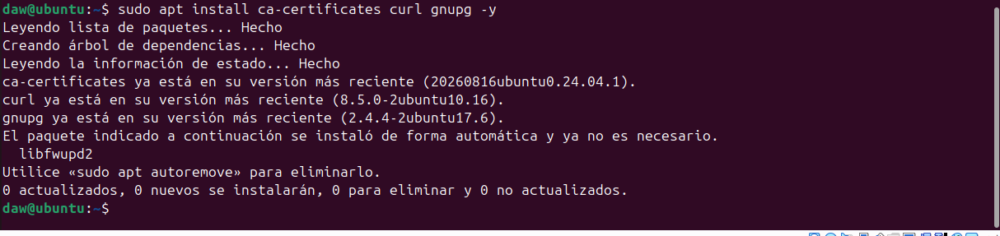

## 5. Instalación de Docker Engine

El comando que utilicé fue:

```bash
curl -fsSL https://get.docker.com | sudo sh
```

Este comando descargó y ejecutó el script de instalación de Docker. En las capturas se ve cómo configura el repositorio, instala los paquetes y arranca el servicio. Lo que quedó instalado fue Docker Engine Community, que permite gestionar los contenedores desde la terminal. He corregido el título anterior que lo llamaba Docker Desktop, porque no es la aplicación gráfica de Desktop.

Las capturas muestran los datos del cliente y del servidor de Docker y los mensajes finales del instalador.

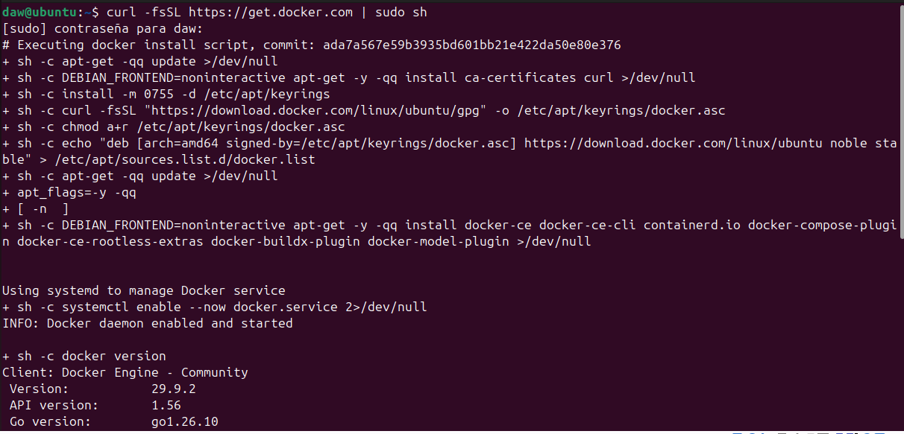

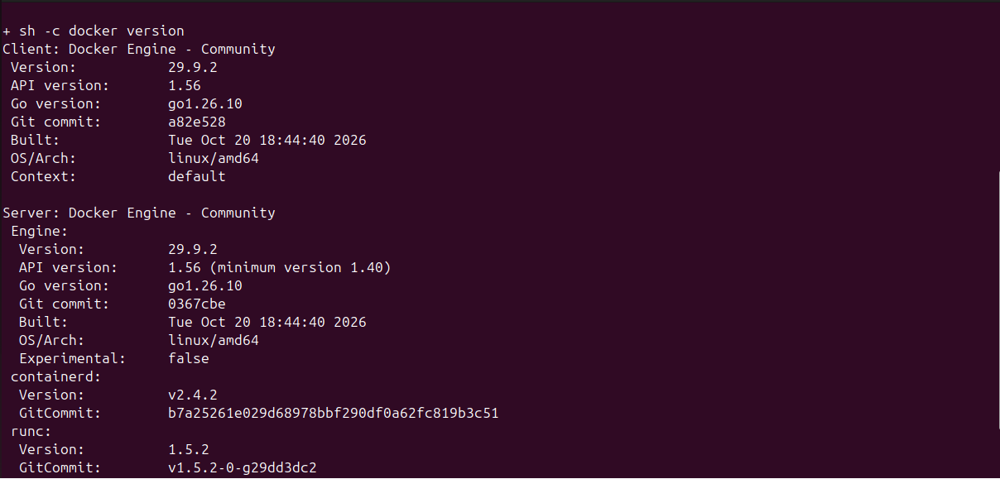

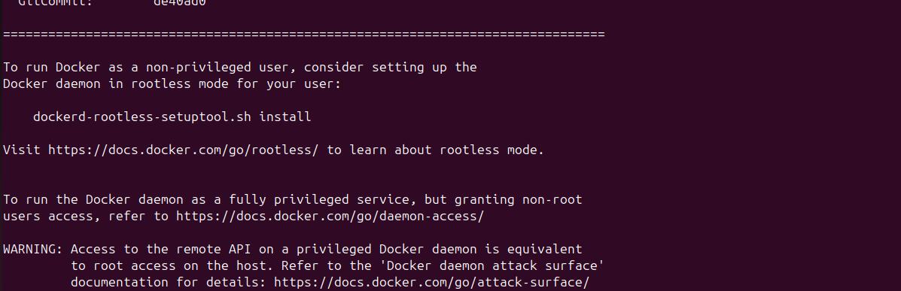

## 6. Comprobación de Docker

Comprobé la versión y ejecuté un contenedor de prueba:

```bash
docker --version
sudo docker run hello-world
```

Primero apareció un mensaje indicando que la imagen no estaba disponible localmente. Docker la descargó y después mostró «Hello from Docker!». Ese mensaje confirma que pudo ejecutar el contenedor correctamente.

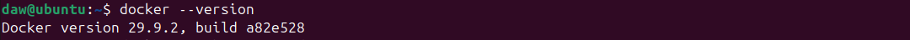

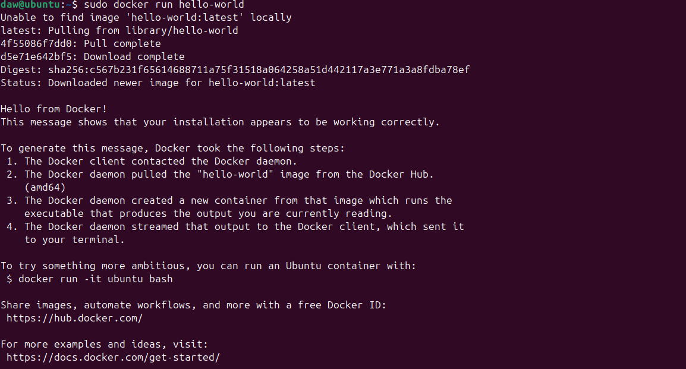

## 7. Comprobación de Docker Desktop y virtualización anidada

Para revisar si podía utilizar Docker Desktop dentro de la máquina virtual, ejecuté:

```bash
cat /etc/os-release
ls -l /dev/kvm
grep -E -c '(vmx|svm)' /proc/cpuinfo
```

El sistema era Ubuntu 24.04 LTS, /dev/kvm no estaba disponible y el último comando devolvió 0. Con esa configuración, la máquina virtual no estaba recibiendo las funciones de virtualización necesarias.

Apagué la máquina y revisé Configuración → Sistema → Procesador en VirtualBox, pero la opción de VT-x/AMD-V anidado aparecía desactivada y no se podía marcar. Finalmente continué la práctica con Docker Engine, que ya funcionaba para ejecutar Nginx y Tomcat. Docker Desktop no quedó instalado; si se exige expresamente, queda pendiente consultar si se acepta Engine.

Estos resultados se documentan a partir de las comprobaciones realizadas durante la práctica; sus capturas no están incluidas en el ODT aportado.

## 8. Búsqueda de imágenes

Busqué las imágenes de los dos servidores:

```bash
sudo docker search nginx
sudo docker search tomcat
```

Los resultados muestran las imágenes disponibles. Para crear los contenedores utilicé las imágenes llamadas nginx y tomcat.

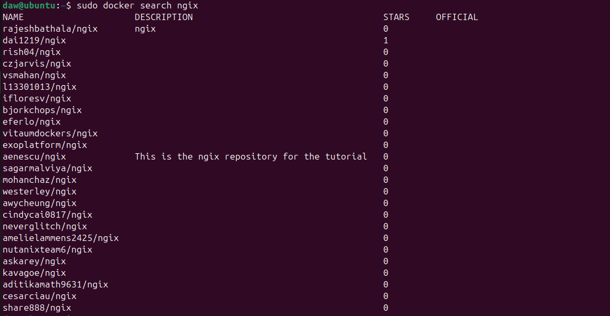

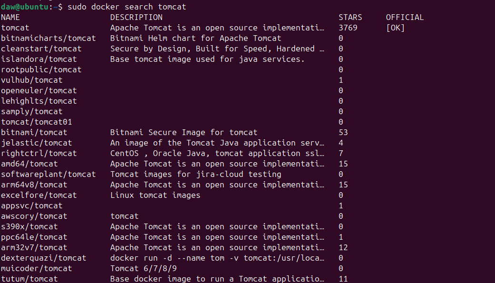

## 9. Creación e inicio de los contenedores

Ejecuté estos comandos uno por uno:

```bash
sudo docker run -d -p 8080:80 --name webserver nginx
sudo docker run -d -p 8081:8080 --name appserver tomcat
```

La opción -d deja el contenedor ejecutándose en segundo plano. --name asigna el nombre al contenedor, no a la máquina virtual. La opción -p relaciona un puerto de Ubuntu con el puerto del contenedor.

Nginx se llama webserver y utiliza el puerto 8080 de Ubuntu, conectado al 80 del contenedor. Tomcat se llama appserver y utiliza el puerto 8081 de Ubuntu, conectado al 8080 del contenedor. Como las imágenes todavía no estaban descargadas, Docker las descargó antes de arrancar los contenedores.

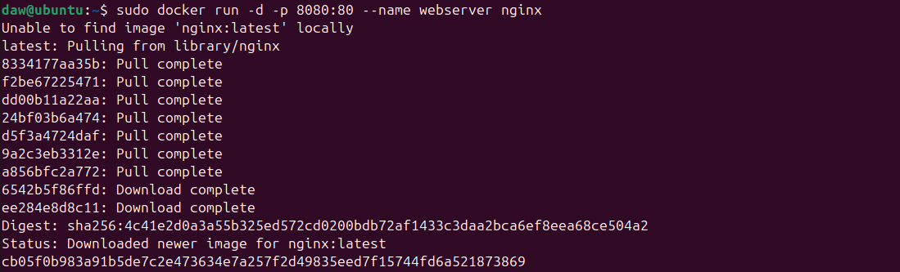

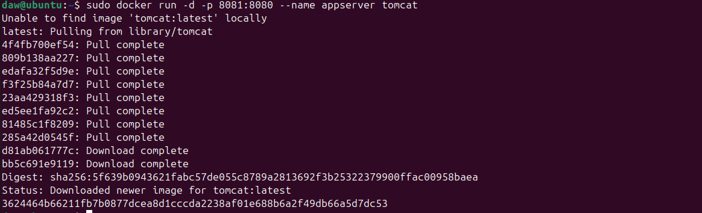

## 10. Comprobación de los contenedores activos

Para comprobar que estaban en marcha ejecuté:

```bash
sudo docker ps
```

Aparecen webserver y appserver con estado Up y sus puertos correspondientes. Esto indica que ambos contenedores estaban ejecutándose en ese momento.

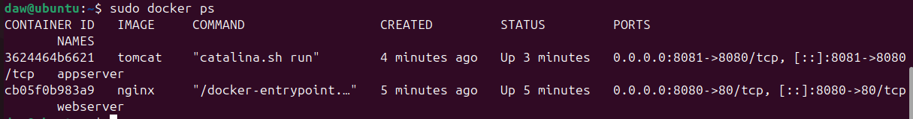

## 11. Comprobación de Nginx en el navegador

Abrí el navegador dentro de Ubuntu y entré en http://localhost:8080. Apareció la página de bienvenida de Nginx, por lo que el servidor web estaba respondiendo correctamente. En esta prueba localhost se refiere al propio Ubuntu de la máquina virtual.

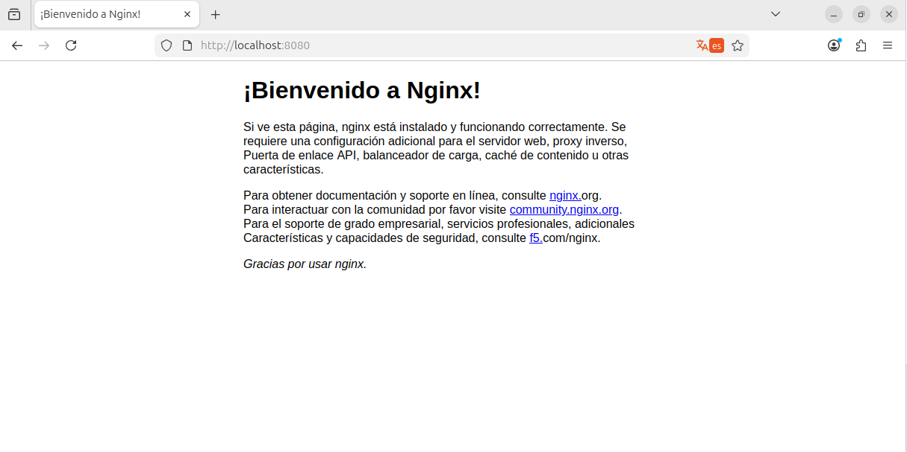

## 12. Error 404 de Tomcat y solución

Al abrir http://localhost:8081 apareció inicialmente un error 404. Tomcat respondía, pero no estaba mostrando la página de bienvenida en esa dirección. Para habilitarla copié la carpeta ROOT desde webapps.dist a webapps.

Durante el proceso corregí varios errores al escribir el comando: utilicé cp -r, mantuve la ruta /usr/local/ y escribí ROOT en mayúsculas. Las rutas no llevan mi nombre de usuario y Linux distingue entre mayúsculas y minúsculas. También tuve que iniciar el contenedor porque estaba parado.

La secuencia que utilicé fue:

```bash
sudo docker start appserver
sudo docker exec appserver cp -r /usr/local/tomcat/webapps.dist/ROOT /usr/local/tomcat/webapps/
sudo docker restart appserver
```

Después volví a http://localhost:8081. Al principio seguía viendo el 404, pero al recargar con F5 apareció la página de bienvenida de Apache Tomcat. La siguiente captura muestra el resultado final correcto.

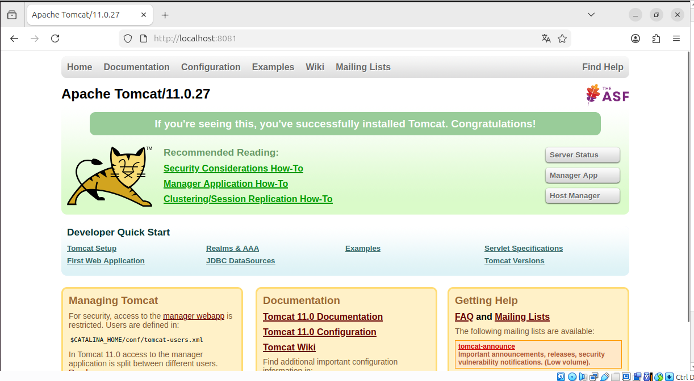

## 13. Requisitos de una aplicación web

Este apartado explica los requisitos generales. No significa que haya instalado o configurado todos estos elementos en la práctica.

Hardware y software. El servidor necesita procesador, memoria RAM y espacio de disco suficientes para la aplicación y sus usuarios. También necesita un sistema operativo, un servidor web y el entorno que use la aplicación. En este caso he utilizado Ubuntu, Docker Engine, Nginx y Tomcat. Si la aplicación guarda información, también puede necesitar una base de datos.

Infraestructura de red. Debe existir conexión entre los usuarios y el servidor. Hay que configurar los puertos y, si se usa un nombre de dominio, el DNS. En esta práctica la máquina tiene red NAT y las pruebas se han hecho desde su propio navegador. Los puertos publicados son 8080 y 8081; eso no demuestra por sí solo que los servicios sean accesibles desde Internet.

Configuración de los servidores. El servidor web debe tener configurados el puerto y la ubicación de los archivos que sirve. El servidor de aplicaciones necesita el entorno adecuado y la aplicación desplegada. En la práctica, Nginx sirve su página de bienvenida y Tomcat muestra la aplicación ROOT después de copiarla a webapps. No se ha desplegado una aplicación propia ni una base de datos.

Seguridad y mantenimiento. Para una aplicación real habría que mantener el sistema y las imágenes actualizados, limitar los puertos abiertos, utilizar contraseñas seguras y permisos adecuados, configurar HTTPS y hacer copias de seguridad. También conviene revisar los registros de errores. Si se guardan datos en contenedores, hay que preparar almacenamiento persistente para no depender solo de sus archivos internos. Estas medidas se describen como requisitos; no se presentan como tareas ya realizadas.

## 14. Resultado final

He conseguido ejecutar Nginx y Tomcat en dos contenedores y acceder a sus páginas de bienvenida desde Ubuntu. Docker funciona, como muestra la prueba hello-world, y el error 404 de Tomcat quedó solucionado al copiar ROOT y recargar el navegador.

La práctica se ha realizado con Docker Engine. Quedan sin acreditar Docker Desktop, la ampliación del disco de 25 a 50 GB y la instalación completa de Guest Additions. No los doy por hechos porque no se han confirmado.

