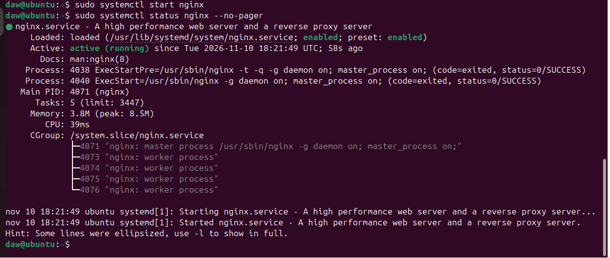
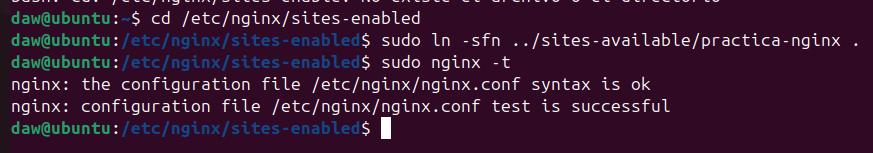
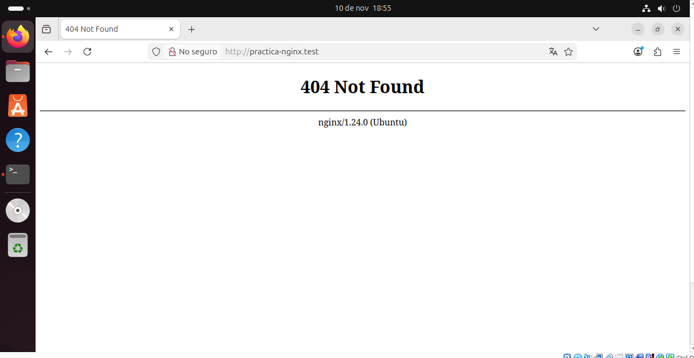
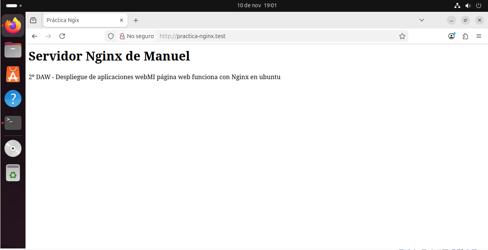
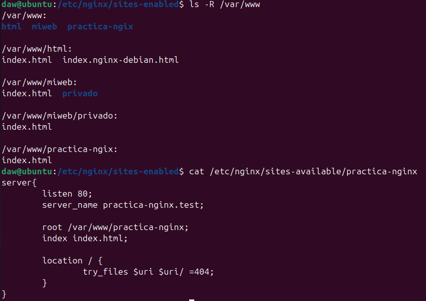

# Instalación y configuración de Nginx en Ubuntu

Alumno: Manuel · IES Juan Bosco · 2º DAW
Módulo: Despliegue de Aplicaciones Web
Fecha: 10 de noviembre de 2026

En esta práctica he instalado Nginx en una máquina virtual con Ubuntu y he configurado una página propia. Al terminar, he podido abrirla desde Firefox usando http://practica-nginx.test. En esta memoria explico la teoría, los pasos realizados y los fallos que he corregido.

## 1 Investigación

### Qué es Nginx

Nginx es un servidor web de código abierto. Recibe peticiones del navegador y devuelve recursos como páginas HTML, imágenes y archivos CSS. También puede funcionar como proxy inverso, enviando las peticiones a otra aplicación, y como caché HTTP. En esta práctica lo he utilizado para servir una página HTML local. [1, 2]

### Diferencias con Apache

| Aspecto | Nginx | Apache |
|---|---|---|
| Sitios web | Bloques server. | Bloques VirtualHost. |
| Conexiones | Modelo basado en eventos y procesos de trabajo. | Depende del MPM: prefork, worker o event. |
| Configuración por carpeta | No interpreta archivos .htaccess. | Admite .htaccess cuando se permite su uso. |
| PHP | Se comunica con un intérprete externo, como PHP-FPM. | Puede usar PHP-FPM o un módulo PHP compatible. |

Los dos sirven páginas web. No se puede decir que uno sea siempre más rápido: depende de la configuración y del trabajo que tenga que hacer. Apache también puede trabajar con un MPM basado en eventos. [2, 3, 4]

### Instalación y ejecución en Ubuntu

Se instala desde los repositorios con apt. El servicio se gestiona con systemctl: start lo inicia, status muestra su estado y reload aplica una configuración nueva. Antes de recargar, conviene comprobarla con nginx -t. [1, 5]

## 2 Instalación y preparación

Primero comprobé Apache. Como estaba activo y podía ocupar el puerto 80, lo detuve para utilizar Nginx en ese puerto. No desinstalé Apache ni borré su práctica.

```
sudo systemctl status apache2
sudo systemctl stop apache2
```

Después actualicé la lista de paquetes, instalé Nginx y comprobé el servicio:

```
sudo apt update
sudo apt install nginx
sudo systemctl start nginx
sudo systemctl status nginx --no-pager
```



Captura 1. Nginx aparece como active (running), por lo que el servicio está en marcha.

Al entrar en http://localhost apareció la página predeterminada de Apache. El nombre de esa página no identifica por sí solo al servidor que responde: el archivo HTML de Apache seguía en /var/www/html y podía mostrarlo Nginx. Para la práctica configuré una carpeta y un nombre propios.

### Creación de la página

Creé una carpeta y un archivo index.html con el título «Servidor Nginx de Manuel» y un texto sobre la práctica. Estas son las rutas correctas que quedaron al final:

```
sudo mkdir -p /var/www/practica-nginx
sudo nano /var/www/practica-nginx/index.html
```

Al principio escribí el nombre de la carpeta como practica-ngix. Más adelante lo corregí, como explico en el apartado de dificultades.

## 3 Configuración del servidor

El enunciado habla de VirtualHost. En Nginx su equivalente es el bloque server. Guardé la configuración en /etc/nginx/sites-available/practica-nginx, con este contenido final:

```
server {
    listen 80;
    server_name practica-nginx.test;

    root /var/www/practica-nginx;
    index index.html;

    location / {
        try_files $uri $uri/ =404;
    }
}
```

listen indica el puerto. server_name identifica el sitio. root señala la carpeta de la web e index establece el archivo inicial. try_files busca el recurso solicitado y devuelve un error 404 si no lo encuentra.

Activé el sitio con un enlace dentro de sites-enabled. Tras corregir los errores de escritura, utilicé estos comandos:

```
cd /etc/nginx/sites-enabled
sudo ln -sfn ../sites-available/practica-nginx .
```

### Nombre local del sitio

Abrí /etc/hosts y añadí esta línea, conservando la entrada miweb.test de otra práctica:

```
sudo nano /etc/hosts

127.0.0.1 practica-nginx.test
```

127.0.0.1 apunta a la propia máquina. Esta entrada permite que Firefox, dentro de Ubuntu, encuentre el sitio. No es un dominio público y no necesita contratarse. El archivo correcto es hosts, con s final.

### Validación y aplicación de cambios

```
sudo nginx -t
sudo systemctl reload nginx
```

Primero validé la configuración y después la recargué. La validación correcta confirma que Nginx puede leer la configuración, pero no garantiza que exista la carpeta de la página; eso se comprueba al abrirla.



Captura 2. El resultado muestra syntax is ok y test is successful.

## 4 Comprobación en el navegador

Después de corregir el archivo hosts, Firefox ya llegaba a Nginx, aunque inicialmente recibía un error 404. La respuesta mostraba nginx/1.24.0 (Ubuntu), lo que permitía identificar al servidor que estaba respondiendo.



Captura 3. El nombre local ya funciona, pero Nginx todavía no encuentra la página.

Al corregir el nombre de la carpeta y recargar el navegador, apareció la página personalizada en http://practica-nginx.test. Con esta prueba queda verificado el acceso al sitio configurado.



Captura 4. Resultado final con la dirección del sitio y la página de Manuel visibles.

El aviso «No seguro» aparece porque la conexión utiliza HTTP. En esta práctica no se ha configurado HTTPS. El texto de los párrafos aparece seguido, pero eso es un detalle del HTML y no impide que el servidor entregue la página.

## 5 Dificultades y soluciones

Los problemas principales fueron errores al escribir nombres y rutas a mano:

• Enlace roto: escribí de forma distinta el nombre del archivo o la carpeta sites-enabled. nginx -t avisó de que no encontraba el archivo. Lo solucioné corrigiendo la ruta y volviendo a crear el enlace con ln -sfn.

• Sintaxis: la primera configuración tenía incompleta la línea try_files. La dejé como try_files $uri $uri/ =404;, respetando los espacios y el punto y coma.

• Nombre no encontrado: edité /etc/host en lugar de /etc/hosts. Añadí la entrada en el archivo correcto y el navegador pudo resolver el nombre.

• Error 404: la carpeta se llamaba practica-ngix, mientras que root apuntaba a practica-nginx. Revisé las carpetas y el archivo de configuración para comparar los nombres:

```
ls -R /var/www
cat /etc/nginx/sites-available/practica-nginx
```



Captura 5. Arriba se ve practica-ngix; en root se busca practica-nginx. Esa diferencia causaba el 404.

Renombré la carpeta y actualicé Firefox. No hizo falta reiniciar Nginx porque la configuración ya apuntaba a la ruta correcta.

```
cd /var/www
sudo mv practica-ngix practica-nginx
```

## 6 Conclusiones

He conseguido instalar Nginx, configurar un sitio propio y acceder a él desde Firefox en Ubuntu. También he aprendido a activar el sitio mediante un enlace, validar la configuración y aplicar los cambios con una recarga.

Lo que más problemas me dio fue escribir los nombres de las rutas. Una sola letra distinta provocaba que Nginx no encontrase el archivo o que el navegador no encontrase el nombre local. Comparar la configuración con las carpetas reales me ayudó a localizar el error.

La comprobación final fue abrir la página personalizada. El servicio activo y la validación correcta eran pasos necesarios, pero hasta ver la página no podía dar por terminada la práctica.

## 7 Fuentes consultadas

[1] Ubuntu. Instalación y configuración de Nginx.
https://ubuntu.com/tutorials/install-and-configure-nginx

[2] Nginx. Guía para principiantes.
https://nginx.org/en/docs/beginners_guide.html

[3] Apache. Módulos de multiprocesamiento.
https://httpd.apache.org/docs/2.4/mpm.html

[4] Apache. Archivos htaccess.
https://httpd.apache.org/docs/2.4/howto/htaccess.html

[5] Nginx. Parámetros de línea de comandos.
https://nginx.org/en/docs/switches.html

Fecha de consulta: 10 de noviembre de 2026.
